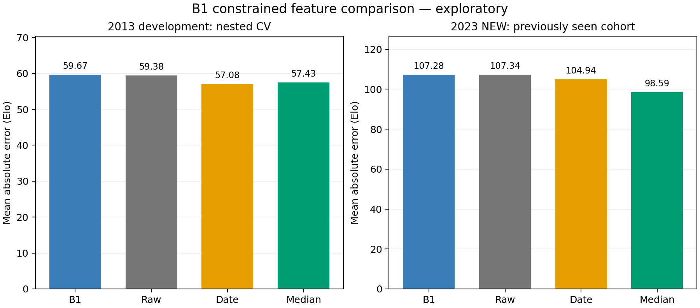

# B1 constrained five-phase features: joint exploratory report

This is a post-A exploratory comparison. Both the 2013 development outcomes
and the 2023 NEW outcomes had already been examined. The 2023 table is not a
new blind test. Every B1 structural parameter and Ridge alpha was selected
using only 2013 inner folds; every final model was sealed before 2023 loading
and scoring. No model or parameter was selected from the tables below.

## Prediction errors

| Cohort | Model | People | MAE | RMSE | Spearman |
| --- | --- | --- | --- | --- | --- |
| 2013 nested CV | B1 structured Ridge | 1000 | 59.672 | 74.848 | -0.036 |
| 2013 nested CV | Raw Ridge | 1000 | 59.382 | 74.602 | -0.020 |
| 2013 nested CV | Date Ridge | 1000 | 57.083 | 72.163 | 0.191 |
| 2013 nested CV | Training median | 1000 | 57.434 | 75.391 | -0.099 |
| 2023 NEW (seen) | B1 structured Ridge | 500 | 107.282 | 124.929 | 0.001 |
| 2023 NEW (seen) | Raw Ridge | 500 | 107.337 | 124.965 | -0.004 |
| 2023 NEW (seen) | Date Ridge | 500 | 104.936 | 121.360 | 0.190 |
| 2023 NEW (seen) | Training median | 500 | 98.588 | 115.561 | — |

2013 numbers pool one outer held-out prediction for each of 1,000 people;
each outer training set contains 800. The final models are refitted on all
1,000 development people and scored on the same previously seen 500-person
2023 NEW cohort. Training medians are fitted separately within each outer
training fold, or on all development data for 2023. A constant prediction has
undefined Spearman correlation, shown as a dash. The pooled outer medians can
vary between folds, so their pooled correlation need not be undefined.

| Cohort | Comparison | Paired mean absolute-error difference |
| --- | --- | --- |
| development_nested_cv | b1_minus_raw | 0.291 |
| development_nested_cv | b1_minus_date | 2.589 |
| development_nested_cv | b1_minus_median | 2.238 |
| previously_seen_2023_new | b1_minus_raw | -0.055 |
| previously_seen_2023_new | b1_minus_date | 2.347 |
| previously_seen_2023_new | b1_minus_median | 8.694 |

Differences are B1 minus comparator on the same people: **negative favors B1**.
They are descriptive, with no new p-value or formal confidence claim. These
raw/date comparators use Ridge only; the raw comparator is not the earlier
A1 procedure that selected among five model families.

## Selected constrained weights

| Fit | Ridge alpha | Main | Middle | Residual | Month branch | Selected inner MAE |
| --- | --- | --- | --- | --- | --- | --- |
| outer-0 | 1000.000 | 1.000 | 0.750 | 0.188 | 3.000 | 59.552 |
| outer-1 | 1000.000 | 1.000 | 0.750 | 0.562 | 3.000 | 58.970 |
| outer-2 | 1000.000 | 1.000 | 0.250 | 0.062 | 3.000 | 59.291 |
| outer-3 | 1000.000 | 1.000 | 0.750 | 0.562 | 3.000 | 58.889 |
| outer-4 | 1000.000 | 1.000 | 0.750 | 0.562 | 1.000 | 60.016 |
| final | 1000.000 | 1.000 | 0.250 | 0.062 | 1.000 | 59.419 |

Main qi is fixed at 1 to set a ratio scale. Middle is selected from
{0.25, 0.5, 0.75}, residual is middle times a ratio in {0.25, 0.5, 0.75},
and the month-branch multiplier is selected from {1, 1.5, 2, 3}. Thus every
candidate satisfies main > middle > residual > 0 and month >= 1. The final
selection is middle 0.25, residual 0.0625, month
1. Across the five outer fits plus final, 6/6
selections touch at least one structural grid boundary. Boundary choices and
variation across these dependent fits do not identify an optimum beyond the
grid or establish a reliable physical strength estimate. The grid is not
expanded in response to these results.

## What was tested

All models use the fixed Random1000 sample, the original shuffled five outer
folds and four inner folds, fold-local input and target standardization, and
the same five Ridge alpha values. B1 searches 36 structural settings times
five alphas (180 candidates); raw and date Ridge each search five candidates.
Search budgets are unequal. There are 0 invalid candidate searches
and 0 recorded warnings across inner fitting entries; complete
candidate, fold, failure and refit records are preserved. Each representation
has its own inner selection; selection is repeated inside every outer fold.

B1 retains the 66 position-specific raw one-hot columns and adds 20 columns:
five pooled phase fractions, five fractions relative to the day-master phase,
five generating-pair products and five controlling-pair products. Visible
stems each contribute one unit. A branch mixes only its present hidden stems,
normalizing their role weights to one unit; only the month branch is then
multiplied by the month parameter. Pooled masses are divided by 5 + month.
These operations occur before the training-fold StandardScaler, so the
weights affect the mixture rather than being canceled as independent-column
scales. The paired products are defined features, not measured causal flows,
and no auspicious/adverse Elo sign is imposed.

The project’s versioned hidden-stem priority table is used, including 巳 =
丙、戊、庚. List slots are assigned main, middle, residual; absent slots are
zero. For 午 = 丁、己 and 亥 = 壬、甲, the second slot receives middle weight.
This is an explicit operational definition, not a claim that all traditional
schools agree on qi labels or on the ordering in another calendar library.

For fixed structural weights, these added features are expressible within
A1’s full pairwise raw-feature space. B1 therefore tests parameter sharing
and regularization, not new birth information or additional expressivity.
Keeping raw columns also lets the readout compensate through raw coefficients:
the ordering constraints apply to constructed input forces, not to final Elo
marginal effects. Learned weights cannot be read as true traditional forces.
No birth-hour information, branch clashes, combinations or additional rules
were added. Better performance here would require confirmation on a sample
not used for model development; worse performance does not rule out all BaZi
functions or establish that a missing hour must matter.

## Reproducibility

Source-lock SHA256: `e4c8d94c334b0ba41ea99fe587c4d55c1a9cdc582174df5467277ee65592c610`.
Fitted-model seal SHA256: `ff3b8839a04cf7c5ea9cf7126cba9db54badba176c60ef65489c4955ac0f8f75`.
The machine-readable summary and checkpoint bundle record all six complete
training tasks, selected candidates, final model hashes and prediction hashes.
The original A1 source, data and results are unchanged.
